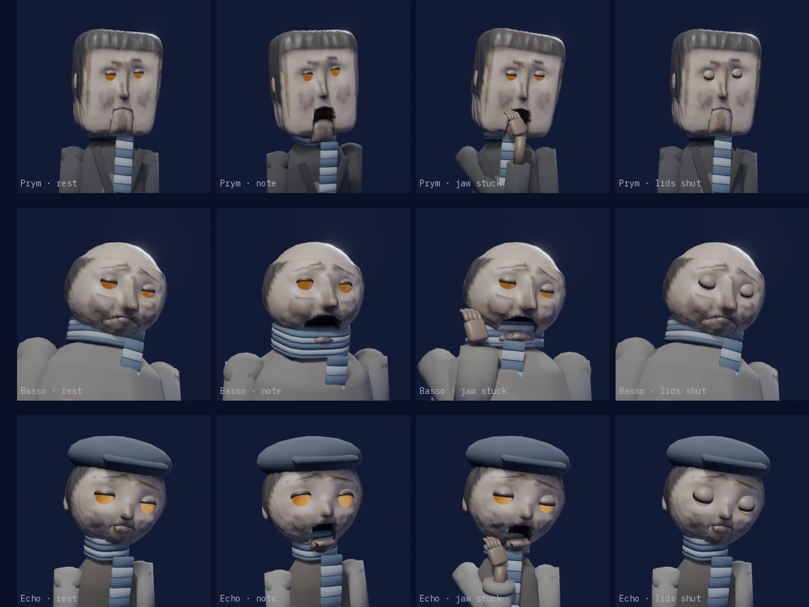
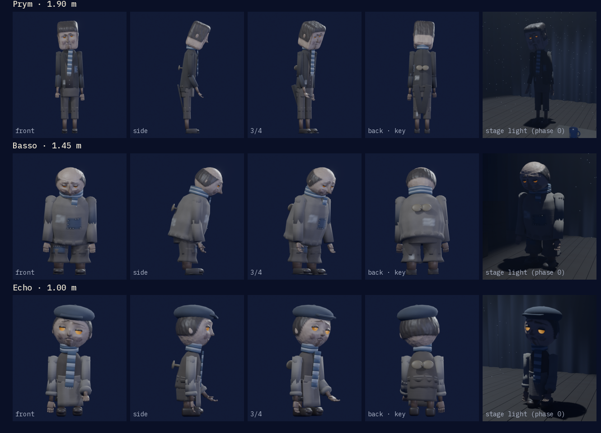

# Choir Rehearsals: the characters

Three game-ready 3D characters from **Choir Rehearsals**, a series of short night-camera episodes on [kinari.church](https://kinari.church). Free to use in your games, films and experiments under CC BY 4.0.



## The characters

| | |
|---|---|
| **Prym** | The tallest, with a square head. Leads the count and cannot stand a wrong note. |
| **Basso** | Round head, the lowest voice. Always half a beat late, always sorry. |
| **Echo** | The smallest. Repeats the last move of anyone near her, and she is the one who moves things. |



## Files

| File | Size (bytes) | SHA-256 |
|---|---|---|
| `glb/choir_prym.glb` | 1346500 | `66315a0719f77759693613f9561034c00e1625e79ce478744cd7d6132f4819bc` |
| `glb/choir_basso.glb` | 1428740 | `2a6e04a66a308f868252cc9d94045b56290b28d2fb342ea60eb195c8f25bf4fc` |
| `glb/choir_echo.glb` | 1456140 | `6d57ad9c97821c1ed759da4680b8d695eefeb2daf4deeb1d424cdd15a43b648c` |

Verify with `shasum -a 256 -c SHA256SUMS`. A zip with the three GLBs, this README, the licence and the credits is attached to each release (`choir-v1.0.0.zip`).

## Rig details

Measured from the GLB files themselves.

| | Prym | Basso | Echo |
|---|---|---|---|
| Triangles | 9662 | 9622 | 9388 |
| Meshes / skins | 1 / 1 | 1 / 1 | 1 / 1 |
| Bones (skin joints) | 20 | 20 | 20 |
| Materials | 3 (`Mat_Prym_Wood`, `_Cloth`, `_Eye`) | 3 (`Mat_Basso_*`) | 3 (`Mat_Echo_*`) |
| Textures | colour 2048 px, normal 2048 px, eye emission 1024 px | same | same |
| Animations | 9 | 9 | 9 |

- Texture images are embedded in the GLB as JPEG. Materials use base colour and normal maps; the eye material also has an emission map (the eyes glow amber).
- Bones: `root`, `pelvis`, `spine`, `neck`, `head`, `jaw`, `lid_L`, `lid_R`, and left and right `arm`, `forearm`, `hand`, `thigh`, `shin`, `foot`. One bone per rigid part.
- The 9 poses are glTF animations with the same names on all three characters: `pose_rest`, `pose_note`, `pose_bow`, `pose_bow_stuck`, `pose_conduct`, `pose_head_tilt`, `pose_jaw_stuck`, `pose_listen`, `pose_caught`.
- Exported from Blender 5.3 with the Khronos glTF I/O add-on (glTF 2.0, no extensions).
- These are game models, not watertight print models. Expect to close holes and add thickness before 3D printing.

## How to use

**Blender.** File > Import > glTF 2.0. Poses are actions; switch them in the Action Editor.

**three.js.** Load with `GLTFLoader`; each pose is an `AnimationClip` you can play with `AnimationMixer`. See [`examples/three.html`](examples/three.html).

```js
const gltf = await new GLTFLoader().loadAsync('glb/choir_echo.glb');
const mixer = new THREE.AnimationMixer(gltf.scene);
mixer.clipAction(THREE.AnimationClip.findByName(gltf.animations, 'pose_bow')).play();
```

**`<model-viewer>`.** See [`examples/model-viewer.html`](examples/model-viewer.html).

```html
<model-viewer src="glb/choir_echo.glb" camera-controls animation-name="pose_bow"></model-viewer>
```

**Godot.** Drop the GLB into the project; Godot 4 imports glTF natively and exposes the poses in an `AnimationPlayer`.

**Unity.** Add the [glTFast](https://github.com/atteneder/glTFast) package (Package Manager, `com.unity.cloud.gltfast`), then drop the GLB into `Assets`. The rig has 20 bones, one per rigid part.

## Licence

[Creative Commons Attribution 4.0 International (CC BY 4.0)](LICENSE). Commercial use is allowed. Please credit:

> Choir Rehearsals characters by Kinari (kinari.church), CC BY 4.0

A short, non-binding request: please do not use the characters to hurt anyone.

## Not in this repository

Voices, music, the CCTV overlay, the seal and the fonts used in the series. See [`CREDITS.md`](CREDITS.md).
